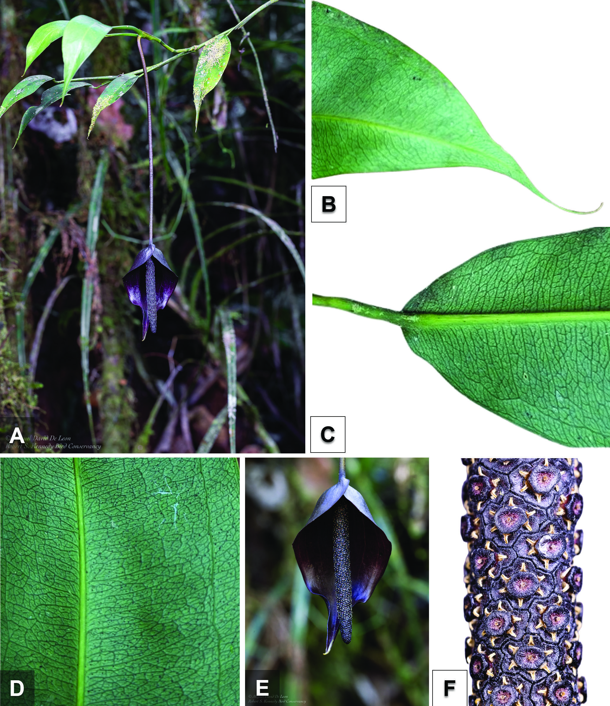

# PDF 物理第 3 页（原刊页码 185）

> 来源：原 PDF 文本层提取；保留原文，不是重新 OCR 或 AI 解读。表格阅读顺序须以左侧 PDF 为准。

185PhytoKeys 247: 183–190 (2024), DOI: 10.3897/phytokeys.247.130721
Maria Melanie P . Medecilo-Guiang & Derek Cabactulan: Pothos deleonii, new species from Bukidnon, Philippines
tened, shallowly sinuate to slightly conduplicate, 15.5–26.3 cm long by 4–6 cm 
wide, apex acuminate to caudate and thickened, base acute to obtuse, slightly 
cordate in juvenile stage, adaxially slightly glossy, dark green and abaxially pale 
green. Venation closely pinnate, brochidodromous, midrib pale green, adaxially 
flattened and abaxially rounded raised, primary lateral veins arising running at 
the base of midrib towards the intra-marginal veins, secondary veins arising 
at each primary lateral vein, close-spaced disorganized reticulated towards 
Figure 1. Pothos deleonii M.P Medecilo-Guiang and D. Cabactulan A habit with flowering branch B leaf apex C leaf base 
D venation pattern E inflorescence F detail of spadix.

