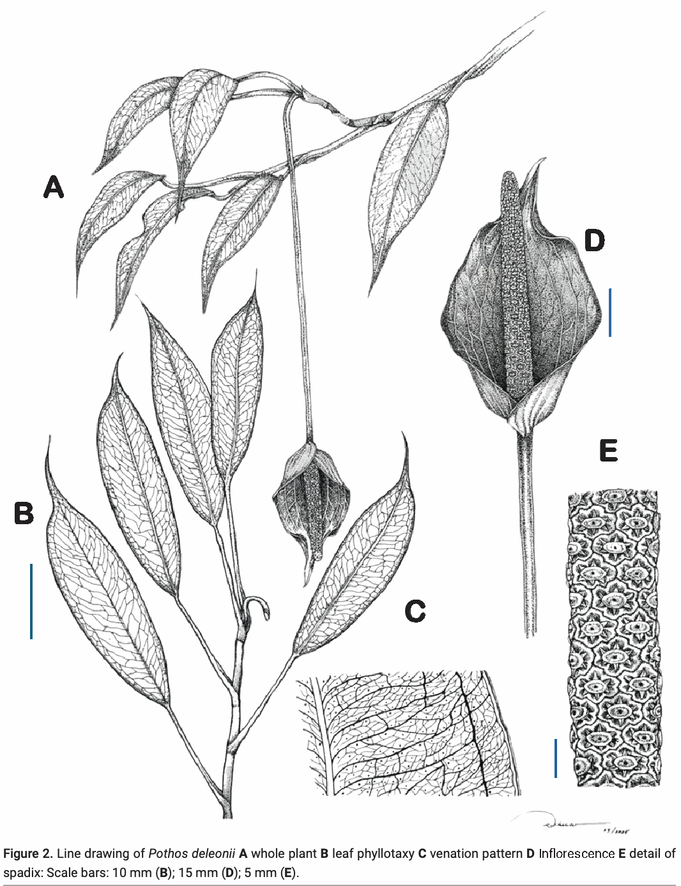

# PDF 物理第 4 页（原刊页码 186）

> 来源：原 PDF 文本层提取；保留原文，不是重新 OCR 或 AI 解读。表格阅读顺序须以左侧 PDF 为准。

186PhytoKeys 247: 183–190 (2024), DOI: 10.3897/phytokeys.247.130721
Maria Melanie P . Medecilo-Guiang & Derek Cabactulan: Pothos deleonii, new species from Bukidnon, Philippines
the intra-marginal vein, 2 intra-marginal veins on both sides of the leaf, arising 
from the base of midrib towards the apex, disorganized reticulated, primary 
intra-margins 6.5–9.0 mm wide, secondary intra-margins 0.8–1.0 mm wide, 
venation adaxially less prominent to absent when fresh and slightly present 
Figure 2. Line drawing of Pothos deleonii A whole plant B leaf phyllotaxy C venation pattern D Inflorescence E detail of 
spadix: Scale bars: 10 mm (B); 15 mm (D); 5 mm (E).
A
B
C
D
E

